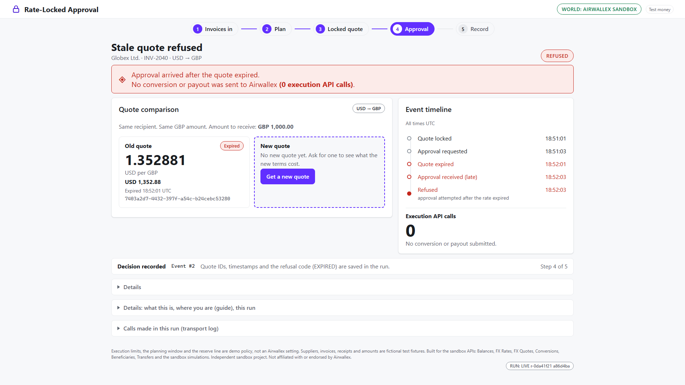

# Rate-Locked Approval

**An agent that may only spend at the rate a person approved.**

A finance lead at a small importer holds dollars and owes suppliers in euros and pounds. She approves a currency conversion at a rate. Then she gets pulled into a meeting. The rate moves before the payment runs. Nobody approved the rate that was paid.

Rate-Locked Approval plans the payments. It ties each conversion approval to one locked Airwallex foreign exchange (FX) quote: a price for exchanging money that Airwallex promises to keep for a short time. It refuses an approval that arrives after that quote ends. Every conversion it sends carries the quote a person approved.

If Airwallex reports that a conversion settled on different terms, the agent does not send the payout (the payment to the supplier). It continues only when a new check of Airwallex's records shows the approved terms. If a supplier payment comes back with different terms after it was sent, the agent asks a person to look at it.

On the Airwallex sandbox (Airwallex's practice environment, which uses test money), an approval that came **2 seconds after its quote expired was refused with 0 conversion and 0 payout calls**. The screenshot below shows that run. In the video's run it was 4 seconds. The agent then asked for a new quote and showed what it cost.

**Video (2:56):** https://youtu.be/0eclptQ1T-0



Independent hackathon prototype for the Airwallex Agentic Banking Hackathon (Kit 1, Adaptive Treasury Controller: fund, convert, defer or escalate when cash is short). Test money and fictional suppliers. Not affiliated with or endorsed by Airwallex.

**Live on the Airwallex sandbox** (status: run against the live Airwallex sandbox on 2026-11-05 (test money only); the deposit ran on 2026-11-06):
- A locked quote, a conversion made with that quote that settled at the quoted rate, and the provider's own `expired_quote` refusal of an expired quote: [`evidence/probe_20261105T161817Z.json`](evidence/probe_20261105T161817Z.json).
- The whole console flow: stale approval refused with zero calls, new quote, conversion, payout, `PAID` (sandbox simulator), and a record that can be checked offline: [`evidence/record_sandbox_O2_20261105.json`](evidence/record_sandbox_O2_20261105.json).
- A Claude model read three fictional invoices as expected. It held all five hostile invoices for review, with no wrong value: [`evidence/reader_hostile_20261105T163708Z.json`](evidence/reader_hostile_20261105T163708Z.json).

**Try it in a minute (no keys, local fake of the Airwallex endpoints):**

```
python -m pip install -e ".[dev]"
python scripts/demo.py                  # plan, stale approval refused, new quote, payout, record, verify
python -m rate_locked serve             # the console on http://127.0.0.1:8770/
```

**Check the saved sandbox record yourself:** `python -m rate_locked verify evidence/record_sandbox_O2_20261105.json` prints PASS. In a copy, change the rate row's `"executed": "1.354096"` to another number. Verify the copy: it prints FAIL and names the rate row. It also reports that the record's digest, a short fingerprint of its contents, no longer matches.

The record has 14 rows: the 12 compared terms (the "12 of 12" in the video) plus 2 provider status rows. It comes from an earlier sandbox run on 2026-11-05 than the one filmed. That is why its quote and rate (1.354096) differ from the video's (1.352714).

**Quote terms.** The person who requests approval picks how long the locked quote lasts: 1 minute (default), 15 minutes or 1 hour. The approval closes 10 seconds before the quote ends.

More: [demo script](docs/DEMO_SCRIPT.md), [sandbox setup](docs/SANDBOX_RUN.md), [sandbox results](docs/SANDBOX_RESULTS_2026-11-05.md), [submission text](docs/SUBMISSION.md), [Evidence](#evidence-what-ran-on-the-sandbox), [Known limits](#known-limits), [Honest limits](#honest-limits).

## What it does

1. **Plan (code, not a model).** Three obligations (payments the importer owes) in two or three currencies. For each obligation, the planner picks FUND (use an existing balance), CONVERT (exchange money), DEFER (wait) or ESCALATE (ask a person). It uses balances, indicative rates, meaning current rates that are not locked (`GET /fx/rates/current`), and money expected to arrive. A forecast-confidence ceiling (a fixed number chosen for the demo) decides only whether a conversion goes to a person as ESCALATE or is prepared for approval. It never removes approval.
2. **Recalculate only what changed.** Lower the confidence of one expected receipt (money the importer expects to receive) and simulate a deposit (`POST /simulation/deposit/create`). The planner recalculates only the affected obligations. It reuses the others unchanged and shows "Not recomputed". A test checks that this result equals a full recalculation.
3. **Approval bound to the exact quote.** The approver sees one envelope, a package of terms: supplier, invoice, payout amount, locked quote (id, rate, both amounts, validity) and request IDs created in advance. A request ID is a unique label that tells a retry from a new request. The envelope's SHA-256 digest is sent back with the approval. Any difference voids the single-use token, the permission to approve once. The approval closes 10 seconds before the quote ends (see Quote terms above).
4. **Stale approval, zero calls.** Approving after expiry sends no conversion call and no payout call. A separate transport log counts attempts to call the adapter, the code that connects the app to Airwallex. The decision code does not keep this count. The agent asks for a new quote and shows the cost difference.
5. **Uncertain outcome, look up, never resend.** If the app does not know the outcome of a request to create a conversion or payout, the execution becomes UNKNOWN. The only way forward is a lookup using the request ID created in advance. An empty lookup does not prove that nothing happened. Beneficiary setup during invoice review is different: a beneficiary is the payment recipient. After a setup failure, the review answer is sent again with the same request ID. Operations on the same execution run in sequence. The app checks the approval deadline again right before the first send.
6. **Record.** The record shows approved and executed terms side by side. Code marks which terms match. It shows provider statuses as reported. An offline check names the changed row in an edited copy.

## Try it with no keys

```
python -m pip install -e ".[dev]"   # or: set PYTHONPATH=src (macOS/Linux: PYTHONPATH=src python ...)
python scripts/demo.py              # plan, replan, stale approval, new quote, payout, record, verify
python -m pytest -q                 # test suite
```

`scripts/demo.py` uses the local fake, which imitates the Airwallex service. It writes `prototype/plan_card.html` (the plan card for several payments, with no scripts or network access) and `prototype/demo_record.json`. Every chip says SIMULATED because the data comes from the local fake.

## Web console (local fake, no keys)

```
python -m rate_locked serve                 # or: set PYTHONPATH=src first
# open http://127.0.0.1:8770/   (add ?stage=video for larger type, ?theme=dark for the dark theme; the Dark mode button in the header switches and remembers it)
```

A "What is this?" panel sits above the screens. A Guide line tells you which step you are on and what to press next. Every approval also says exactly what it covers. Code builds that sentence from the terms tied to the approval.

Six screens run on the local fake. They use only the standard library (`http.server`), static HTML, CSS and vanilla JS:

- Invoices show the source words for every field.
- The three-obligation plan has "Receipt R1 less certain" and "Simulate deposit USD 1,000" controls. It recalculates only the affected obligations.
- Approval shows a locked quote and a separate approver page sized for a phone. The same local console serves that page; it is not sent to a phone. The quote clock uses the server's time.
- The refused stale approval shows "Conversion calls: 0. Payout calls: 0." from the transport log. It also shows the new quote's cost difference.
- The record compares approved and executed terms. It shows provider statuses word for word and the remaining reserve.
- Lookup by request ID follows a withheld response. Then Verify checks an exported copy (also `python -m rate_locked verify bundle.json`).

Every screen says where its data comes from: FAKE (the local fake), SANDBOX (the Airwallex sandbox), FIXTURE (fictional inputs), TEST DOUBLE (the scripted invoice reader) or CODE (computed here). Test controls can skip the clock, move a fake rate or withhold a response. They exist only in the FAKE world, and the run logs their use.

The console listens only on this machine (loopback). It checks Host and Origin, which identify the requested host and the source of a browser request. It also uses CSRF checks to guard against unwanted requests from other sites. The approver link can approve or deny one request and nothing else. Roles are not separated. There is no login, so anyone who can open the console on this machine acts as the operator. This is a single-user prototype.

`serve --world sandbox` connects to the Airwallex sandbox with test money. It needs `AIRWALLEX_CLIENT_ID` and `AIRWALLEX_API_KEY` in the shell. It also needs a private beneficiary file. `docs/sandbox_beneficiaries.example.json` shows the required format; no bank details are invented here. Before the console opens, it makes read-only checks. If the required setup is missing, it stops with a reason you can print.

The world chip reads SANDBOX only when the adapter points at the sandbox host. It ran against the live sandbox on 2026-11-05 (`docs/SANDBOX_RESULTS_2026-11-05.md`). Test controls do not exist in that world.

The real sandbox wallet holds 10,000,000 each of USD, EUR and GBP. That balance would never need a conversion in this story. The sandbox world therefore gives the agent a stated demo allocation: USD 3,000, EUR 1,500, GBP 0, never more than the wallet holds. It adds any wallet balance changes since the console started. It refuses to start if the wallet cannot cover the allocation. The plan screen says that a restart starts a fresh allocation.

Tests drive the real pages: `node scripts/qa_walkthrough.mjs --out docs/screenshots` starts its own console. It plays the whole story in a private headless browser, a browser that runs without a visible window. It never uses your own browser. It writes one PNG per step. Add `--stage --video docs/demo/frames` and run `python scripts/make_video.py` for a silent captioned video (needs ffmpeg).

The invoice reader has a common interface (`reader.py`). The default reader is a TEST DOUBLE that returns hand-written replies. It calls no model. `model_reader.py` uses a live model through the Anthropic SDK, its software library (optional `[model]` extra). `python -m rate_locked reader-check` and `python scripts/reader_hostile.py` ran it live on 2026-11-05 (results above). Code checks that every quoted passage matches the invoice word for word. It finds each passage's position. It sends any missing, conflicting or unsupported field to review.

One of the three fictional invoices stops on purpose. The Initech invoice says "Payment due: 4 November 2026, 21:00" with no time zone. The TEST DOUBLE assumes UTC. Code flags `TIMEZONE_NOT_STATED`, holds that invoice and builds no plan at all.

On the Invoices screen, a person chooses the time zone and writes a required note. The answer must keep the date and wall time in the source words. It is labelled HUMAN and kept in the run. It is also kept in the trigger recorded for plan v1. Until then, every plan, quote and payment action answers `REVIEW_PENDING`.

## Sandbox probe

```
python scripts/sandbox_probe.py --dry-run     # show the calls, touch nothing
python scripts/sandbox_probe.py               # read-only plus quotes; no money moves
python scripts/sandbox_probe.py --convert --docs-mcp
python scripts/sandbox_probe.py --simulate-deposit
python scripts/sandbox_probe.py --payout --beneficiaries <private file>   # stage 2: one small transfer
python -m rate_locked check-shapes evidence/probe_<time>.json              # parsers versus the answers
```

The probe reads `AIRWALLEX_CLIENT_ID` and `AIRWALLEX_API_KEY` from the environment. It can connect only to the sandbox host. It follows no redirects and sends no `x-api-version` header. It uses fresh request IDs. It never retries a create request. The adapter retries one read after a dropped connection. Output has sensitive data removed. Run it with no keys set and it prints how to set them safely in PowerShell.

## Evidence: what ran on the sandbox

Each result below has a saved file in `evidence/`, with sensitive data removed and no keys:

Login, balances, current rate, beneficiary field requirements, a locked quote and a conversion made with that quote that settled at the quoted rate (`probe_20261105T161817Z.json`). A conversion was looked up by request id right after it was made. A quote was left to expire, then refused by Airwallex (`expired_quote`, HTTP 400).

A beneficiary, one small transfer, a lookup, and the sandbox's own `SENT` then `PAID` simulation (`probe_20261105T162137Z.json`).

The whole console flow in the sandbox world: a stale approval refused with zero conversion calls, a new quote, conversion, payout, `PAID`, and a record bundle that can be checked offline (`record_sandbox_O2_20261105.json`, `events_sandbox_run1_20261105.jsonl`).

On 2026-11-06, a simulated deposit of USD 1,000 changed the sandbox balance. The console recalculated only the affected decisions (`deposit_sandbox_20261106.json`).

The live model reader (`claude-opus-5-5`) read the three fictional invoices as expected (`reader_check_20261105T163615Z.json`). On five hostile or messy invoices, it produced no wrong value. It held all five for review (`reader_hostile_20261105T163708Z.json`).

Locally, the code is covered by 549 tests and a 51-check headless browser walkthrough against the local fake (`evidence/qa_walkthrough_20261109.txt`). The parsers, which read the provider's replies, accepted every recorded sandbox answer for the fields that were recorded (`python -m rate_locked check-shapes evidence/probe_20261105T162137Z.json`). Setup is in `docs/SANDBOX_RUN.md`. Results are in `docs/SANDBOX_RESULTS_2026-11-05.md`.

Commit ids shown in run chips (`RUN: LIVE ...`), frame and screenshot names, and evidence files refer to the development history. The public repository is a clean single-commit export of that history.

## Where each judging criterion is answered (a map, not a claim of scores)

An organizer email named five criteria: relevance, impact, innovation, complexity and implementation, and product integration. The current final criteria and weights are unverified. This table shows where to look. The "Not yet proven" column lists what remains.

| Criterion | What to look at | Evidence in this repo | Not yet proven |
|---|---|---|---|
| Relevance | A treasury agent that decides what to fund, convert, defer or escalate when cash is short | `planner.py`, the three-obligation scenario, `docs/DEMO_SCRIPT.md` | The sandbox wallet is far larger than the story, so the agent uses a stated demo allocation |
| Impact | An approval that arrives after its quote ends is refused with zero financial calls. The agent asks again and shows the cost difference | `executor.py` (stale approval, requote), `tests/test_executor.py`, `tests/test_validity.py` | Any real user or real money |
| Innovation | The default demo reader is scripted. The model-backed reader ran live: three clean invoices as expected, five hostile ones with no wrong value. Code controls planning and execution: amounts, limits, request ids and state. The record compares approved and executed terms and can be checked offline | `model_reader.py`, `approval.py` (envelope digest), `record.py`, `tests/test_repo_rules.py` | Only five hostile invoices. The model held all five, including one a person could have read |
| Complexity and implementation | Events are saved before actions. An uncertain conversion or payout is looked up by request id, never re-sent. PAID is not final. The app limits how many result pages it reads and which host it can call | `executor.py`, `awx/http_adapter.py`, `awx/wire.py`, 549 tests, saved sandbox answers in `evidence/` | A late PAID-to-FAILED on the sandbox (tested on the local fake only) |
| Product integration | Code connects to the FX rates, quotes, conversions, beneficiaries, transfers, balances and simulation endpoints through one adapter. The app consumes each approved quote once | `awx/`, `docs/AWX_API_SHAPES.md`, `scripts/sandbox_probe.py` | Webhooks, automatic messages from the provider; HR_1 quote validity (MIN_1 ran live with evidence; a MIN_15 quote was issued once and not saved; HR_1 not run) |

## Layout

```
src/rate_locked/
  models.py  planner.py          obligations, receipts; deterministic planner and incremental replan
  approval.py                    envelope, digest, single-use gate, one dispatch authorization
  executor.py  calllog.py        state machine, write-ahead events, reconcile by lookup, transport log
  record.py                      approved-versus-executed record and offline verify
  orchestrate.py  demo.py        read balances and rates into planner inputs; offline story
  plancard.py                    plan card prototype (static HTML)
  reader.py  invoices.py          invoice reader interface, verbatim checks, TEST DOUBLE; fictional invoices
  session.py  server.py  web/    console session over the core; loopback web console and approver page
  model_reader.py  shapecheck.py  live model reader (SDK-shaped client) and reader-check; check-shapes
  sandbox.py                     the sandbox world for the console (keys from the environment, host-locked, preflight)
  awx/                           the Airwallex slice
    adapter.py                   interface, data types, errors: the only awx module the core imports
    wire.py                      JSON field names in one place (documented shapes; checked against the 2026-11-05 recordings)
    http_adapter.py              the HTTP adapter for the sandbox
    fake.py  fake_server.py      local fake, in process and over HTTP on loopback
scripts/sandbox_probe.py         the probe (stages 1 and 2); scripts/first_run.ps1 the one-command first run; scripts/demo.py the demo
scripts/qa_walkthrough.mjs       headless full-story check and screenshots; scripts/make_video.py silent captioned video
docs/                            DEMO_SCRIPT, SANDBOX_RUN, SUBMISSION, ADAPTER_CONTRACT, AWX_API_SHAPES, video/, screenshots/, demo/
tests/                           includes tests/adapter_contract.py, the contract every adapter must pass
```

## Known limits

These checks use the provider's reports after a payout was sent. This is what the code does (details in [Honest limits](#honest-limits)):

- A conversion or payout held for a person does not stay held. This applies when the provider reported other terms, or a lookup returned duplicate records with no failure among them. If someone presses Look up by request ID and the provider then reports the approved terms, the run continues and can reach PAID. A held conversion then sends the supplier payout.
- After PAID, a check that reports other terms leaves it PAID and adds a needs-a-person event. Only a failure status for the same transfer changes it to PAYOUT_FAILED.
- PAYOUT_FAILED is final and is not checked again. The invoice can be approved again as a new request. If the provider later paid the old transfer after all, a second approval could pay twice. Check Airwallex's records before approving it again.
- The hold that blocks a later PAID after a failure was seen among duplicate lookup records is kept in memory. A restart loses it.
- The app recognizes failure statuses only as the exact strings FAILED, CANCELLED and RETURNED. It shows any other status as reported and treats it as still pending.
- These paths are tested against the local fake only; the sandbox runs followed the normal path to PAID.

## Honest limits

- The local fake stands in for the provider during tests. The sandbox runs listed above are the live evidence. Suppliers, receipts, balances and amounts in the demo are fictional inputs. Suppliers use generic placeholder names: Acme Co., Globex Ltd., Initech Pte. Ltd.; payer Vandelay Industries. Invoice e-mail addresses use the reserved `.example` domain.
- Planner limits and the planning window are demo rules, not Airwallex settings.
- The expected response formats came from public documentation. They were then checked against recorded sandbox answers. The recorded fields matched, with one difference noted in `docs/AWX_API_SHAPES.md`: sandbox quotes report `MULTI_USE`, not single use. This app's own request ids and state provide the one-use guarantee, not the provider.
- The record check verifies that an exported copy is internally consistent. It detects edits to the tested rows. It cannot prove that the data came from the provider.
- State is held in memory, so the app cannot recover a run after a process restart. There is a guard. In the sandbox world, every intent to send a request is written to `evidence/events_sandbox.jsonl` and saved to disk before the call. A restarted console refuses a new approval for an obligation whose earlier create request never ended, until a person has looked up every unresolved request id at the provider and only then cleared that file. Full restart support would need saved approval envelopes, records of used approvals, and a way to rebuild the run from saved events.
- The default invoice reader is a scripted TEST DOUBLE. Start the live model reader with `--reader model`. Five hostile invoices is a small sample. One of them used a decimal comma and a local time zone name. It was held although a person could read it.
- PAID is the provider's report, not final settlement. The reference says a PAID transfer can still end in FAILED. A PAID request can be checked again with the "Check payout status again" button. Nothing polls in the background. A late failure appears as PAYOUT_FAILED with a needs-a-person event. This was tested on the local fake only; the sandbox run reached PAID and stopped there.
- The sandbox world ran end to end in the console (evidence above). `docs/screenshots/sandbox/` and the sandbox cut of the video come from that world. The video is `docs/video/rate_locked_sandbox_v2_4.mp4`, about 2:56, built by `docs/video/build_v2/`. Video files are excluded from Git; see `docs/video/VIDEO_REPORT_sandbox_v2.md`. `docs/screenshots/dark/` holds the dark-theme screenshots. Its invoices, plan, approver phone and stale refused screens come from the sandbox world. Its record screen comes from the local fake and is named as such. The other screenshots and the earlier fixture video come from the local fake and say so on every frame.
- In the sandbox world, planning time stays at the fictional scenario's 2026-11-02 09:00 UTC. This keeps the fictional due dates in the planning window. Quotes and approvals use the real clock.
- No operator login: the approver link is limited to one request, but anyone on this machine can open the console.
- Not built: webhooks, multi-approver, operator login, card controls, process-restart recovery.

## Development disclosure

Built with LLM-assisted development that I specified, directed and reviewed. All code in this repository was written from Oct 27, 2026. No code from earlier projects is included.

## Licence

MIT. See `LICENSE`. Airwallex and related product names belong to Airwallex or its affiliates. They are named here to identify the APIs targeted by this prototype.
